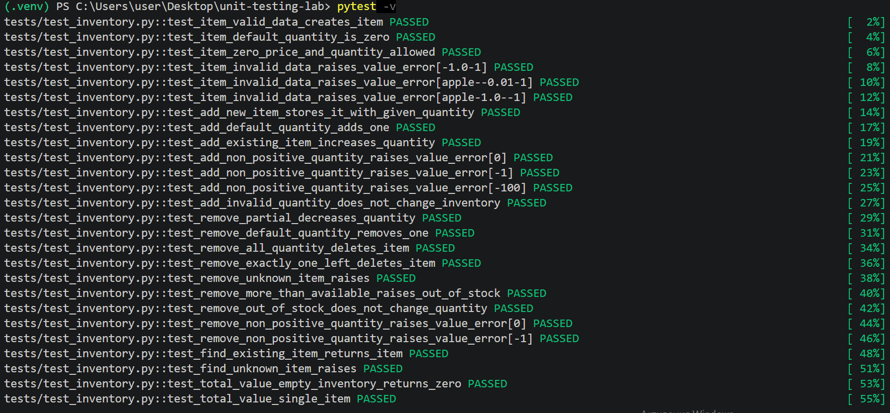
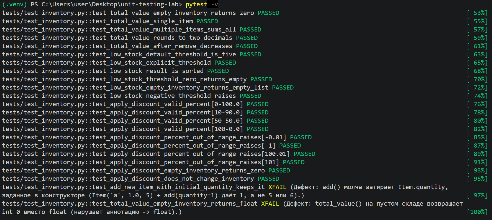

# Unit Testing Lab

Лабораторная работа по модульному тестированию.

## Запуск

```bash
python -m venv .venv
.venv\Scripts\activate
pip install -r requirements.txt
pytest
pytest --cov=src --cov-report=term-missing
```

## Отчёт о покрытии

Команда генерации HTML-отчёта:

```bash
pytest --cov=src --cov-branch --cov-report=term-missing --cov-report=html --cov-report=xml
```

Текущее покрытие: **100 %** (50 из 50 строк, 24 из 24 ветвей). Результат: 45 passed, 2 xfailed.

| Файл | Stmts | Miss | Branch | BrPart | Cover |
|------|-------|------|--------|--------|-------|
| src/inventory.py | 50 | 0 | 24 | 0 | 100 % |

Скриншоты:


Непокрытых участков нет. Код из покрытия не исключался.
