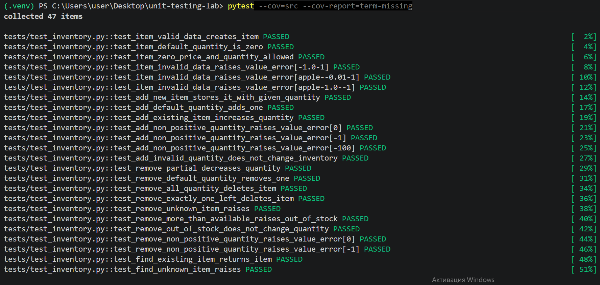
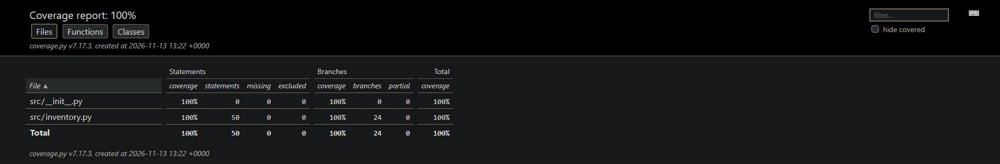

# Отчёт по лабораторной работе «Модульное тестирование»


**Тема:** Модульное тестирование. Написание, запуск тестов и измерение покрытия.  


## 1. Анализ модуля (Шаг 2)

Публичные элементы: `Item`, `Inventory.add`, `remove`, `find`, `total_value`, `low_stock`, `apply_discount`.

| Элемент | Валидные входы | Граничные | Невалидные → исключение |
|---|---|---|---|
| `Item(name, price, quantity)` | непустое имя, price ≥ 0, quantity ≥ 0 | price = 0, quantity = 0 (по умолчанию) | пустое имя, price < 0, quantity < 0 → `ValueError` |
| `add(item, quantity)` | quantity > 0 | quantity = 1 (по умолчанию) | quantity ≤ 0 → `ValueError` |
| `remove(name, quantity)` | существующая позиция, quantity ≤ остатка | quantity = остатку (позиция удаляется), quantity = 1 | quantity ≤ 0 → `ValueError`; нет позиции → `UnknownItemError`; quantity > остатка → `OutOfStockError` |
| `find(name)` | существующее имя | — | нет позиции → `UnknownItemError` |
| `total_value()` | любое состояние склада | пустой склад | — |
| `low_stock(threshold)` | threshold ≥ 0 | threshold = 0, threshold = 5 (значение равное порогу входит) | threshold < 0 → `ValueError` |
| `apply_discount(percent)` | 0 ≤ percent ≤ 100 | 0 и 100 | percent < 0 или > 100 → `ValueError` |

Ветвления (кандидаты на покрытие): `Item.__post_init__` (3 условия); `add` — quantity ≤ 0, существующая/новая позиция; `remove` — quantity ≤ 0, неизвестная позиция, нехватка остатка, обнуление; `find` — позиция есть/нет; `low_stock` — threshold < 0; `apply_discount` — выход за диапазон.

### Чек-лист проверок (24 пункта)

1. Item с корректными данными создаётся.
2. Item: quantity по умолчанию = 0.
3. Item: price = 0 и quantity = 0 допустимы.
4. Item: пустое имя → ValueError.
5. Item: отрицательная цена → ValueError.
6. Item: отрицательное количество → ValueError.
7. add: новая позиция сохраняется с заданным количеством.
8. add: quantity по умолчанию = 1.
9. add: существующая позиция — количество увеличивается.
10. add: quantity ≤ 0 (0, −1) → ValueError, склад не меняется.
11. remove: частичное списание уменьшает количество.
12. remove: списание ровно всего остатка удаляет позицию (в том числе 1 из 1).
13. remove: неизвестная позиция → UnknownItemError.
14. remove: больше остатка → OutOfStockError, остаток не меняется.
15. remove: quantity ≤ 0 → ValueError.
16. find: существующая позиция / несуществующая → UnknownItemError.
17. total_value: пустой склад → 0.
18. total_value: несколько позиций суммируются.
19. total_value: округление до 2 знаков.
20. low_stock: порог по умолчанию = 5, значение равное порогу входит.
21. low_stock: явный порог, порог 0.
22. low_stock: результат отсортирован; пустой склад → [].
23. low_stock: threshold < 0 → ValueError.
24. apply_discount: 0, 10, 50, 100 %; вне диапазона → ValueError; пустой склад; склад не изменяется.

## 2. Тесты (Шаги 3–4)

Файл: `tests/test_inventory.py` — **47 тестов** (с учётом параметризации): 45 проходят, 2 помечены `xfail`.
Использованы: 3 фикстуры (`inventory`, `empty_inventory`, `multi_inventory`), `@pytest.mark.parametrize` для 5 тестов (Item, add, remove, apply_discount ×2), `pytest.approx` для float, `pytest.raises` для `ValueError`, `OutOfStockError`, `UnknownItemError`. Имена в стиле `test_<что>_<условие>_<ожидание>`.

Запуск отдельных тестов:

```bash
pytest -k "discount"
pytest tests/test_inventory.py::test_remove_unknown_item_raises -v
```

Скриншоты:




## 3. Покрытие (Шаги 5–6)

```
Name               Stmts   Miss Branch BrPart  Cover   Missing
src/inventory.py      50      0     24      0   100%
TOTAL                 50      0     24      0   100%
Required test coverage of 85% reached. Total coverage: 100.00%
```

## 4. Ответы на вопросы Шага 7

**Какой процент покрытия достигнут?** Строки: 100 % (50/50), ветви: 100 % (24/24). Порог 85 % выполнен.

**Какие строки не покрыты и почему?** Таких нет. Код из отчёта не исключался. Пробелов в тестах нет.

**Какие тесты наиболее ценные?** Тесты ветвления `remove` (удаление при обнулении, `OutOfStockError` без изменения остатка), тест граничного значения `low_stock` (остаток = порогу = 5 входит) и тесты невалидных значений `apply_discount` на границах диапазона.

**Какие дефекты обнаружены?** Оформлены как `xfail(strict=True)` с пояснением:

1. `add()` при добавлении новой позиции молча перезаписывает `Item.quantity`, заданное в конструкторе: `Item("a", 1.0, 5)` + `add(quantity=1)` даёт 1, а не 5 (или 6). Данные теряются без предупреждения.
2. `total_value()` на пустом складе возвращает `int` `0` вместо `float` (`round(0, 2)` от `sum([])`), что нарушает аннотацию `-> float`. Значения `0 == 0.0`, поэтому обычное сравнение дефект не ловит, нужна проверка типа.

Также стоит отметить (тестами не зафиксировано, это замечания): `Item` принимает `price = nan` (сравнение `nan < 0` ложно), а `add` для уже существующего имени игнорирует цену переданного объекта.

**Почему 100 % покрытие не гарантирует отсутствие дефектов?** Покрытие показывает лишь, что строки выполнялись, а не что результат проверен правильно. Пример из работы: при 100 % покрытии остались оба дефекта выше. Строка `item.quantity = quantity` в `add` выполняется и покрыта, но неверное поведение при ненулевом начальном количестве обнаруживается только тестом на конкретный сценарий. Дефект с `int`/`float` тоже не виден, пока не проверен тип результата.

## 5. Контрольные вопросы

1. **Модульный тест vs интеграционный.** Модульный проверяет одну единицу (функцию, класс) изолированно; интеграционный — взаимодействие нескольких компонентов (БД, сеть, модули вместе).
2. **Фикстура.** Подготовка и очистка окружения для тестов (`@pytest.fixture`), создаётся заново для каждого теста, исключает дублирование кода.
3. **`assert x == y` vs `pytest.approx`.** `==` для float требует точного совпадения и ломается из-за ошибок округления (`0.1 + 0.2 != 0.3`); `approx` сравнивает с допуском.
4. **`pytest.raises`.** Проверяет, что блок кода выбрасывает указанное исключение (можно проверить текст через `match`); если исключения нет, тест падает.
5. **Покрытие по строкам и по ветвям.** Строки — какие инструкции выполнились; ветви — все ли исходы условий (истина/ложь, переходы) пройдены. `if` без `else` может иметь 100 % по строкам, но 50 % по ветвям.
6. **Почему 100 % не гарантирует отсутствие дефектов.** См. ответ выше: покрытие не оценивает качество проверок и не охватывает отсутствующий код и непроверенные сочетания данных.
7. **`xfail` vs `skip`.** `xfail` — тест выполняется, но падение ожидаемо (известный дефект); `skip` — тест не выполняется вовсе (неподходящая платформа, нет зависимости).
8. **Независимость тестов.** Чтобы результат не зависел от порядка и состава запуска, падение одного теста не каскадировало, а тесты можно запускать выборочно и параллельно.

## 6. Выводы

Освоены написание тестов на pytest, параметризация, фикстуры, проверка исключений, `approx`, измерение покрытия по строкам и ветвям, настройка отчётов (консоль, XML, HTML) и CI. Сложность: отличить дефект модуля от ошибки в тесте и не подгонять тесты под код — найденные расхождения оформлены как `xfail`. Главный вывод: высокое покрытие — необходимое, но не достаточное условие качества, важны содержательные проверки.
